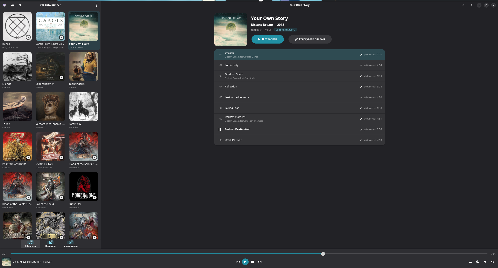
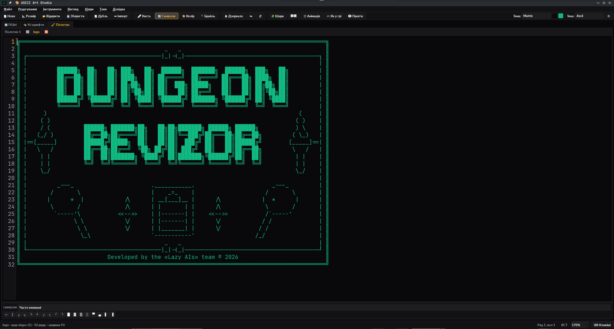
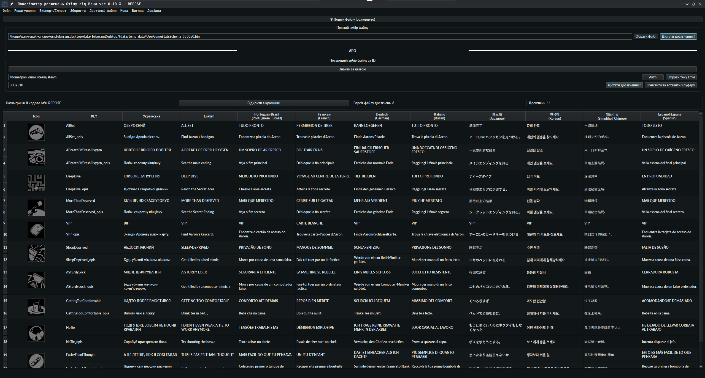

**English** · [Українська](README.uk.md)

```
                                                                                        
▄▄▄   ▄▄  ▄   ▄ ▄ ▄ ▄▄▄▄ ▄   ▄  ▄▄  ▄   ▄▄▄    ▄▄▄  ▄▄▄   ▄▄  ▄▄▄ ▄▄▄▄  ▄▄▄ ▄▄▄▄▄  ▄▄▄  
█▄▄▀ █▄▄█ █▀▄ █ █ █ █▄▄▄ █▀▄ █ █▄▄█  ▀ ▀▄▄▄    █▄▄▀ █▄▄▀ █  █   █ █▄▄▄ █      █   ▀▄▄▄  
█    █  █ █  ▀█ ▀▄▀ █▄▄▄ █  ▀█ █  █     ▄▄▄▀   █    █  █ ▀▄▄▀ ▀▄▀ █▄▄▄ ▀▄▄▄   █    ▄▄▄▀ 

```

I make Linux/KDE apps and tools for Ukrainian game localization.
I also have FIGlet fonts and an ASCII art editor.

<a href="https://github.com/PanVena/cd-auto-runner"></a>
<a href="https://github.com/PanVena/ascii-studio"></a>
<a href="https://github.com/PanVena/SteamAchievementLocalizer"></a>

## Linux & KDE

### Applications and utilities

- **[CD Auto Runner](https://github.com/PanVena/cd-auto-runner)** —
  launches your chosen player for audio CDs, copies discs to your music
  library and helps organize albums. Also has a built-in player.
- **[gdmount](https://github.com/PanVena/gdmount)** —
  mounts Google Drive on Linux with rclone. Creates a user systemd service,
  supports manual and automatic metadata refresh, account switching and KDE
  Plasma.
- **[GPU Tinker](https://github.com/PanVena/gpu_tinker)** —
  shows GPU status, memory and processes; frees a chosen card for
  compute; turns monitors on and off. KDE Plasma, Wayland.

### Kernel and driver tooling

- **[NVIDIA KMod Auto](https://github.com/PanVena/nvidia-kmod-auto)** —
  builds NVIDIA kernel modules for vanilla Fedora kernels.

### KWin and Plasma extensions

- **[KWin Meta Scroll Switcher](https://github.com/PanVena/kwin-meta-scroll-switcher-fedora)** —
  switches virtual desktops with the mouse wheel while Meta is held. Rebuilds
  itself after KWin updates. Fedora.
- **[Proportional cursor crossing for KWin](https://github.com/PanVena/kwin-relative-pointer-fedora)** —
  Plasma Wayland effect that preserves the cursor’s relative height when crossing
  between side-by-side displays, or its relative horizontal position between stacked displays.
- **[OnlyText Date Ukr](https://github.com/PanVena/OnlyText-Date-Ukr)** —
  Plasma 6 widget that spells out the weekday, day and month in the system
  language, Ukrainian included.

## Game localization

**Extracting and importing text**

- **[UnrealLocres UA GUI](https://github.com/PanVena/UnrealLocres-UA-GUI)** —
  GUI for UnrealLocres: export `.locres` to CSV/POT, import translations,
  merge localization files.
- **[UndertaleModTool](https://github.com/PanVena/UndertaleModTool)** ·
  fork — script that exports text from GameMaker games to CSV. Submitted
  upstream as a pull request.
- **[CatalogTool-Linux](https://github.com/PanVena/CatalogTool-Linux)** —
  for Unity games: Addressables catalogs, asset search, export of lists
  and hashes, CRC changes in `catalog.json` and `catalog.bin`.
- **[Translation-tools](https://github.com/PanVena/Translation-tools)** —
  scripts for Unity data (CSV ↔ TXT ↔ XML) and word counts in CSV.

**Editing, translation and proofreading**

- **[Steam Achievement Localizer](https://github.com/PanVena/SteamAchievementLocalizer)** —
  editor for Steam achievement files; translations are exchanged via CSV.
- **[Crowdin Forced Monospace](https://github.com/PanVena/Crowdin-Forced-Monospace)** —
  Crowdin userscript: monospace font for translating the ASCII art in
  *The Talos Principle*.
- **[Text Polisher](https://github.com/PanVena/text-polisher)** —
  proofreads documents through OpenAI-compatible models; saves the corrected
  file and a report with suggestions.

## Text graphics

Made in part for *Dungeon Revizor: The Game*.

- **[ASCII Art Studio](https://github.com/PanVena/ascii-studio)** —
  editor for ASCII and Unicode art: FIGlet fonts, layers, animations.
- **[ANSI Shadow Extended](https://github.com/PanVena/ansi-shadow-extended)** —
  9-row FIGlet font based on ANSI Shadow; Cyrillic and extended Latin.
- **[Blocky 2.5](https://github.com/PanVena/blocky-25)** —
  compact 5-row FIGlet font for interfaces with limited space; Cyrillic
  and extended Latin.

## Games & community

- **[SteamworksPy](https://github.com/PanVena/SteamworksPy)** · fork —
  Python wrapper for the Steamworks API, used in my game; fixes library
  loading and compatibility with PyInstaller and LazyEngine.
- **[Herdling Ukrainian Localization](https://github.com/PanVena/Herdling--UKRAINIZATOR)** —
  Ukrainian localization of *Herdling* and a translated achievements
  scheme for the Steam version 1.3.0.
- **[Progress Visualisation](https://github.com/PanVena/progress-visualisation)** —
  editor for translation progress data; generates a static page with stats
  for the “Lazy AIs” group.
