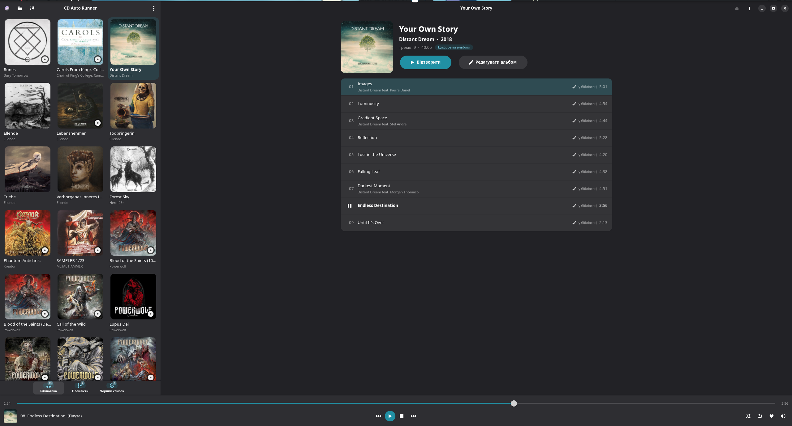
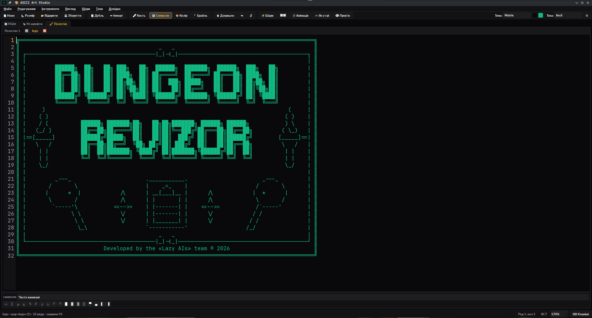
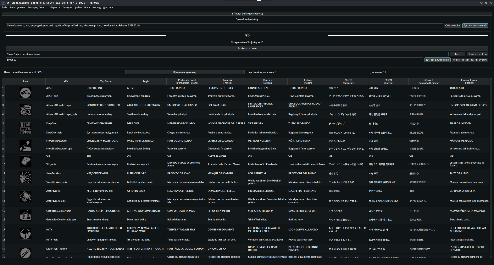

[English](README.md) · **Українська**

```
                                                                                    
▄▄▄▄ ▄▄▄   ▄▄   ▄▄▄ ▄  ▄ ▄▄▄▄▄ ▄   ▄   ▄▄▄▄  ▄▄  ▄  ▄  ▄▄    ▄▄▄  ▄▄▄▄ ▄  ▄ ▄   ▄   
█  █ █▄▄▀ █  █ █▄▄▄ █▄▀    █   █ ▄▀█   █  █ █▄▄█ █▄▄█ █▄▄█   █▄▄▀ █▄▄▄ █▄▄█ █ ▄▀█  
█  █ █    ▀▄▄▀ ▀▄▄▄ █ ▀▄   █   █▀  █   █  █ █  █ █  █ █  █   █▄▄▀ █▄▄▄ █  █ █▀  █  

```

Роблю застосунки для Linux/KDE та інструменти для української локалізації ігор.
Окремо маю FIGlet-шрифти й редактор ASCII-графіки.

<a href="https://github.com/PanVena/cd-auto-runner"></a>
<a href="https://github.com/PanVena/ascii-studio"></a>
<a href="https://github.com/PanVena/SteamAchievementLocalizer"></a>

## Linux і KDE

- **[CD Auto Runner](https://github.com/PanVena/cd-auto-runner)** —
  запускає обраний програвач для аудіо-CD, копіює диски до музичної
  бібліотеки й допомагає впорядкувати альбоми. Має й вбудований програвач.
- **[gdmount](https://github.com/PanVena/gdmount)** —
  монтує Google Drive у Linux через rclone. Створює системну службу
  користувача, підтримує ручне й автоматичне оновлення метаданих,
  зміну акаунта та KDE Plasma.
- **[GPU Tinker](https://github.com/PanVena/gpu_tinker)** —
  показує стан відеокарт, пам’ять і процеси; звільняє вибрану карту для
  обчислень; вмикає й вимикає монітори. KDE Plasma, Wayland.
- **[KWin Meta Scroll Switcher](https://github.com/PanVena/kwin-meta-scroll-switcher-fedora)** —
  перемикає віртуальні стільниці коліщатком із затиснутою Meta. Сам
  перебудовується після оновлень KWin. Fedora.
- **[OnlyText Date Ukr](https://github.com/PanVena/OnlyText-Date-Ukr)** —
  віджет Plasma 6: день тижня, число й місяць словами, мовою системи.

## Локалізація ігор

**Видобування й імпорт текстів**

- **[UnrealLocres UA GUI](https://github.com/PanVena/UnrealLocres-UA-GUI)** —
  графічна оболонка для UnrealLocres: експорт `.locres` у CSV/POT, імпорт
  перекладів, об’єднання файлів локалізації.
- **[UndertaleModTool](https://github.com/PanVena/UndertaleModTool)** ·
  форк — скрипт експорту текстів ігор на GameMaker у CSV. Запропоновано
  в upstream пул-реквестом.
- **[CatalogTool-Linux](https://github.com/PanVena/CatalogTool-Linux)** —
  для ігор на Unity: каталоги Addressables, пошук ресурсів, експорт списків
  і хешів, зміна CRC у `catalog.json` і `catalog.bin`.
- **[Translation-tools](https://github.com/PanVena/Translation-tools)** —
  скрипти для Unity-даних (CSV ↔ TXT ↔ XML) і підрахунку слів у CSV.

**Редагування, переклад і вичитка**

- **[Steam Achievement Localizer](https://github.com/PanVena/SteamAchievementLocalizer)** —
  редактор файлів досягнень Steam; переклади обмінюються через CSV.
- **[Crowdin Forced Monospace](https://github.com/PanVena/Crowdin-Forced-Monospace)** —
  скрипт для Crowdin: моноширинний шрифт для ASCII-графіки в
  *The Talos Principle*.
- **[Text Polisher](https://github.com/PanVena/text-polisher)** —
  вичитка документів через OpenAI-сумісні моделі; зберігає виправлений файл
  і звіт із пропозиціями.

## Текстова графіка

Створені, зокрема, для *Dungeon Revizor: The Game*.

- **[ASCII Art Studio](https://github.com/PanVena/ascii-studio)** —
  редактор ASCII- та Unicode-графіки: FIGlet-шрифти, шари, анімації.
- **[ANSI Shadow Extended](https://github.com/PanVena/ansi-shadow-extended)** —
  9-рядковий FIGlet-шрифт на основі ANSI Shadow; кирилиця й розширена латиниця.
- **[Blocky 2.5](https://github.com/PanVena/blocky-25)** —
  5-рядковий FIGlet-шрифт для інтерфейсів із обмеженим місцем; кирилиця
  й розширена латиниця.

## Ігри та спільнота

- **[SteamworksPy](https://github.com/PanVena/SteamworksPy)** · форк —
  Python-обгортка Steamworks API для моєї гри; виправлено завантаження
  бібліотек і сумісність з PyInstaller та LazyEngine.
- **[Herdling Ukrainian Localization](https://github.com/PanVena/Herdling--UKRAINIZATOR)** —
  українська локалізація *Herdling* і схема перекладених досягнень для
  Steam-версії 1.3.0.
- **[Progress Visualisation](https://github.com/PanVena/progress-visualisation)** —
  редактор даних про поступ перекладів; генерує статичну сторінку зі
  статистикою спілки «Ліниві ШІ».